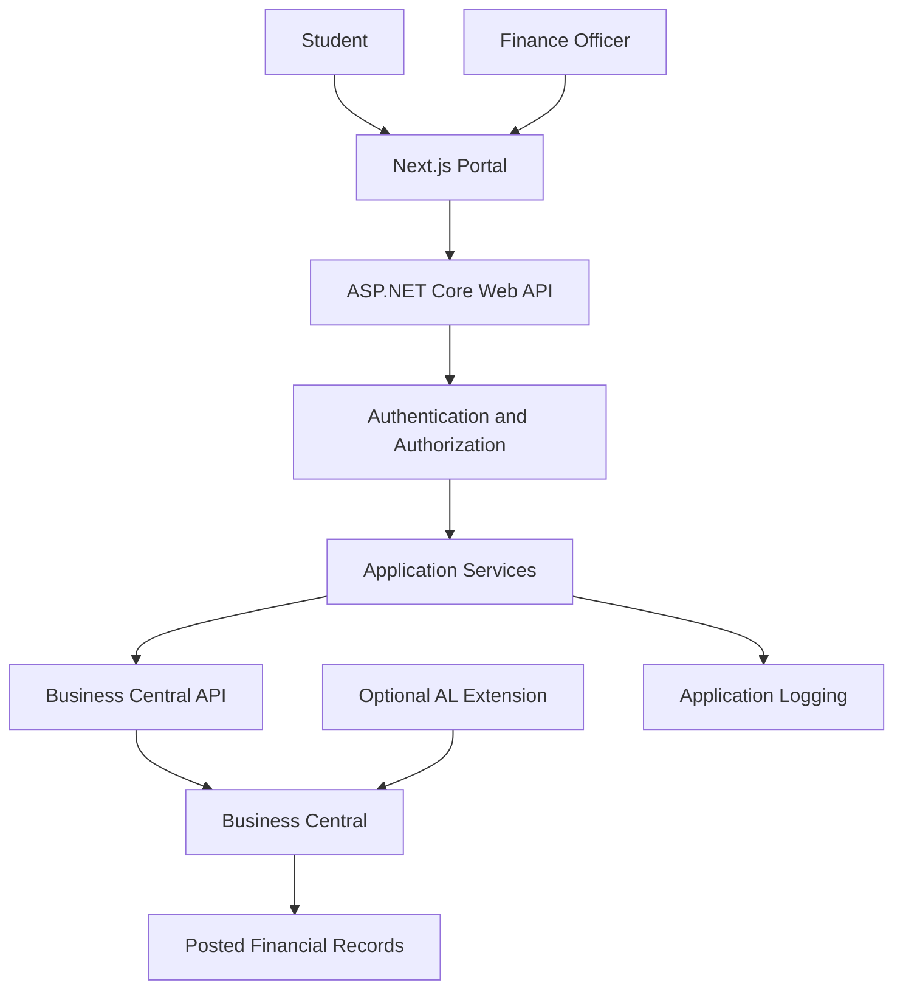

# System Architecture

## 1. Overview

The University Finance Portal uses a frontend, an application backend and Microsoft Dynamics 365 Business Central.

The architecture separates presentation, application coordination and ERP accounting responsibilities.

## 2. Technology Stack

### Frontend

- Next.js
- TypeScript
- React
- Tailwind CSS (proposed)

### Application Backend

- C#
- ASP.NET Core Web API
- Built-in dependency injection
- Swagger/OpenAPI
- HttpClient for outbound Business Central requests

### ERP

- Microsoft Dynamics 365 Business Central
- AL extensions where necessary
- Standard Business Central APIs wherever suitable

### Identity and Security

- Microsoft Entra ID for supported Business Central API authentication.
- A suitable portal-user authentication mechanism.
- Server-side secrets and configuration.

### Testing

- xUnit for .NET unit tests.
- Integration tests for API and Business Central communication.
- Frontend tests as the UI grows.

## 3. High-Level Architecture

## 4. Component Responsibilities

### 4.1 Next.js Frontend

- Render student and finance officer screens.
- Submit requests to the ASP.NET Core API.
- Display financial information returned by the backend.
- Handle loading, validation and error states.
- Never store privileged Business Central credentials in browser code.

### 4.2 ASP.NET Core Backend

- Expose portal-specific REST endpoints.
- Authenticate and authorize requests.
- Validate input and enforce application rules.
- Call Business Central using supported authentication.
- Convert Business Central responses into stable portal DTOs.
- Handle pagination, timeouts and API errors.
- Apply safe retry and duplicate-prevention strategies to write operations.

### 4.3 Business Central

- Maintain relevant ERP records.
- Enforce Business Central validation and posting rules.
- Process supported financial documents and transactions.
- Maintain posted financial and customer ledger entries.
- Provide standard API access and custom AL APIs when needed.

### 4.4 AL Extension

A custom AL extension may be added when a required university-specific entity or operation is not adequately supported by standard APIs.

It must use appropriate permissions and Business Central business logic. It must not bypass posting controls.

### 4.5 Optional Portal Database

A separate database may later store portal-specific information such as identity mappings or workflow metadata.

It must not become an independent source of truth for posted accounting balances.

## 5. Request Lifecycle

1. A user opens the portal.
2. The frontend obtains the user's authenticated session.
3. The frontend calls an ASP.NET Core endpoint.
4. The backend validates identity and authorization.
5. The backend obtains or reuses an appropriately scoped access token.
6. The backend calls the required Business Central API.
7. Business Central returns the permitted result.
8. The backend maps the result to a portal response.
9. The frontend renders the information.

## 6. Integration Strategy

Preferred order:

1. Use an existing standard Business Central API.
2. Confirm that its data and operations satisfy the requirement.
3. If not, implement a custom AL API or supported operation.
4. Consume the standard or custom endpoint through ASP.NET Core.
5. Test permissions, validation, errors and data consistency.

The backend will not connect directly to Business Central's SQL database.

## 7. Environment Strategy

### Development

- Local frontend and ASP.NET Core API.
- Local Business Central development company.
- Fictitious records and test transactions.

### Testing

- Repeatable test data and documented scenarios.
- Automated tests for application services.
- Integration tests against an appropriate development environment.

### Production (future)

- Securely hosted application and API.
- Managed secrets and identity configuration.
- Monitoring, backups and deployment procedures.
- Formal security and financial workflow review.

## 8. Architectural Decisions

- Use ASP.NET Core because it aligns with the Microsoft development environment at AppKings.
- Use AL for Business Central-specific extensions.
- Use Next.js to reuse existing frontend skills.
- Keep financial accounting in Business Central.
- Prefer existing APIs before building custom endpoints.
- Avoid adding a separate database until there is a defined requirement.
- Keep the first release small and expand incrementally.

## 9. Items to Verify

- Business Central version and deployment type.
- Standard API availability.
- Authentication method and required permissions.
- Local API reachability from the .NET application.
- Supported invoice creation and posting operations.
- Whether a custom AL API is actually necessary.
