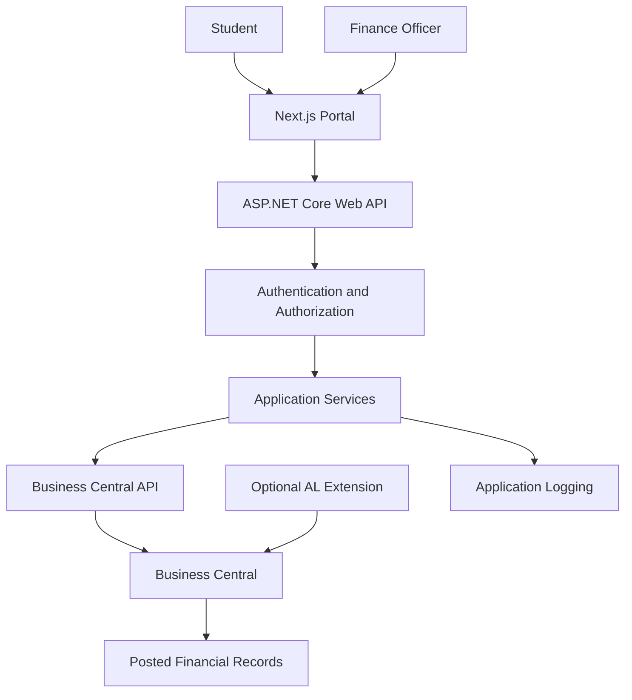

# System Architecture

## 1. Overview

The University Finance Portal uses a frontend, an application backend and Microsoft Dynamics 365 Business Central.

The architecture separates presentation, application coordination and ERP accounting responsibilities.

## 2. Technology Stack

### Frontend

- Next.js
- TypeScript
- React
- Tailwind CSS (proposed)

### Application Backend

- C#
- ASP.NET Core Web API
- ASP.NET Core Identity
- JWT bearer authentication and role-based authorization
- PostgreSQL with Entity Framework Core
- Built-in dependency injection
- Swagger/OpenAPI
- HttpClient for outbound Business Central requests

### ERP

- Microsoft Dynamics 365 Business Central
- AL extensions where necessary
- Standard Business Central APIs wherever suitable

### Identity and Security

- Microsoft Entra ID for supported Business Central API authentication.
- A suitable portal-user authentication mechanism.
- Server-side secrets and configuration.

### Testing

- xUnit for .NET unit tests.
- Integration tests for API and Business Central communication.
- Frontend tests as the UI grows.

## 3. High-Level Architecture



## 4. Component Responsibilities

### 4.1 Next.js Frontend

- Render student and finance officer screens.
- Submit requests to the ASP.NET Core API.
- Display financial information returned by the backend.
- Handle loading, validation and error states.
- Never store privileged Business Central credentials in browser code.

### 4.2 ASP.NET Core Backend

- Expose portal-specific REST endpoints.
- Authenticate and authorize requests.
- Validate input and enforce application rules.
- Call Business Central using supported authentication.
- Convert Business Central responses into stable portal DTOs.
- Provide student payment history using customer ledger entries, converting Business Central's negative payment amounts to positive student-facing amounts and flagging reversed entries.
- Provide finance officers with paged payment records across students, including the student name and currency resolved from the customer record.
- Handle pagination, timeouts and API errors.
- Apply safe retry and duplicate-prevention strategies to write operations.
- Validate Business Central settings at startup and use bounded timeouts, retries and a circuit breaker for outbound requests. Retries are disabled for unsafe HTTP methods.

### 4.3 Business Central

- Maintain relevant ERP records.
- Enforce Business Central validation and posting rules.
- Process supported financial documents and transactions.
- Maintain posted financial and customer ledger entries.
- Provide standard API access and custom AL APIs when needed.

### 4.4 AL Extension

The `business-central/UniversityPortalAPI` AL extension contains a custom API page for customer ledger entries:

```text
business-central/
└── UniversityPortalAPI/
    ├── app.json
    └── src/
        └── CustomerLedgerEntriesApi.Page.al
```

`CustomerLedgerEntriesApi.Page.al` exposes the `Cust. Ledger Entry` table as the `customerLedgerEntries` API entity set (`techworks/universityPortal/v1.0`). It is configured as read-only: insert, modify and delete operations are disabled. The API includes customer, posting, document, due-date, currency, amount, remaining-balance and closure fields; amount FlowFields are calculated when each record is read. The backend queries this API for a signed-in student's payment entries to populate recent payments in the fee statement and the paged payment-history endpoint.

The backend can consume this custom API when standard Business Central APIs do not expose the required ledger-entry data. A custom AL extension must use appropriate permissions and Business Central business logic. It must not bypass posting controls.

### 4.5 Portal Database

PostgreSQL stores portal identity data, including user accounts, roles, student-number mappings and account status. It is not the source of truth for accounting balances or ledger entries; those remain in Business Central.

The schema is managed with Entity Framework Core migrations. Configure `ConnectionStrings:PortalDb` using user-secrets for local development or a managed secret store for deployed environments, then apply migrations before starting the API. The API seeds the Student, FinanceOfficer and Administrator roles at startup. A seed administrator is created only when `Seed:AdminEmail` and `Seed:AdminPassword` are configured and no administrator exists.

Portal users sign in through `POST /api/auth/login`. The API returns a short-lived JWT containing the user's ID, email, name, roles and optional student number. `GET /api/auth/me` returns the authenticated user's token-backed profile. Student and finance-officer finance controllers require their respective roles; other endpoints require authentication by default, except those explicitly marked anonymous such as health and login.

For local development, set the connection string and apply the schema from the API project directory:

```powershell
dotnet user-secrets set "ConnectionStrings:PortalDb" "<postgres-connection-string>"
dotnet user-secrets set "Jwt:SigningKey" "<random-secret-at-least-32-bytes>"
dotnet ef database update
```

The optional seed administrator can be configured with `dotnet user-secrets set "Seed:AdminEmail" "<admin-email>"` and `dotnet user-secrets set "Seed:AdminPassword" "<strong-password>"`.

## 5. Request Lifecycle

1. A user opens the portal.
2. The frontend obtains the user's authenticated session.
3. The frontend calls an ASP.NET Core endpoint.
4. The backend validates identity and authorization.
5. The backend obtains or reuses an appropriately scoped access token.
6. The backend calls the required Business Central API.
7. Business Central returns the permitted result.
8. The backend maps the result to a portal response.
9. The frontend renders the information.

## 6. Integration Strategy

Preferred order:

1. Use an existing standard Business Central API.
2. Confirm that its data and operations satisfy the requirement.
3. If not, implement a custom AL API or supported operation.
4. Consume the standard or custom endpoint through ASP.NET Core.
5. Test permissions, validation, errors and data consistency.

The backend will not connect directly to Business Central's SQL database.

## 7. Environment Strategy

### Development

- Local frontend and ASP.NET Core API.
- Local Business Central development company.
- PostgreSQL database with the API migrations applied.
- Fictitious records and test transactions.

### Testing

- Repeatable test data and documented scenarios.
- Automated tests for application services.
- Integration tests against an appropriate development environment.

### Production (future)

- Securely hosted application and API.
- Managed secrets and identity configuration.
- Monitoring, backups and deployment procedures.
- Formal security and financial workflow review.

## 8. Architectural Decisions

- Use ASP.NET Core because it aligns with the Microsoft development environment at AppKings.
- Use AL for Business Central-specific extensions.
- Use Next.js to reuse existing frontend skills.
- Keep financial accounting in Business Central.
- Use PostgreSQL and ASP.NET Core Identity for portal accounts and role assignments.
- Prefer existing APIs before building custom endpoints.
- Keep the first release small and expand incrementally.

## 9. Items to Verify

- Business Central version and deployment type.
- Standard API availability.
- Authentication method and required permissions.
- Local API reachability from the .NET application.
- Supported invoice creation and posting operations.
- Whether a custom AL API is actually necessary.
