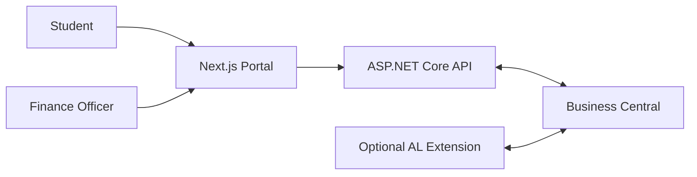
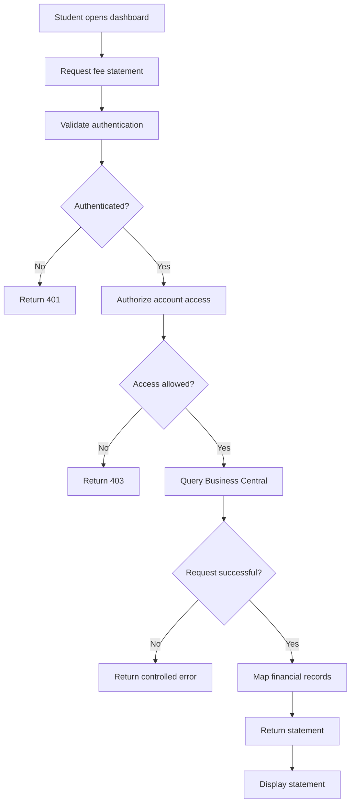
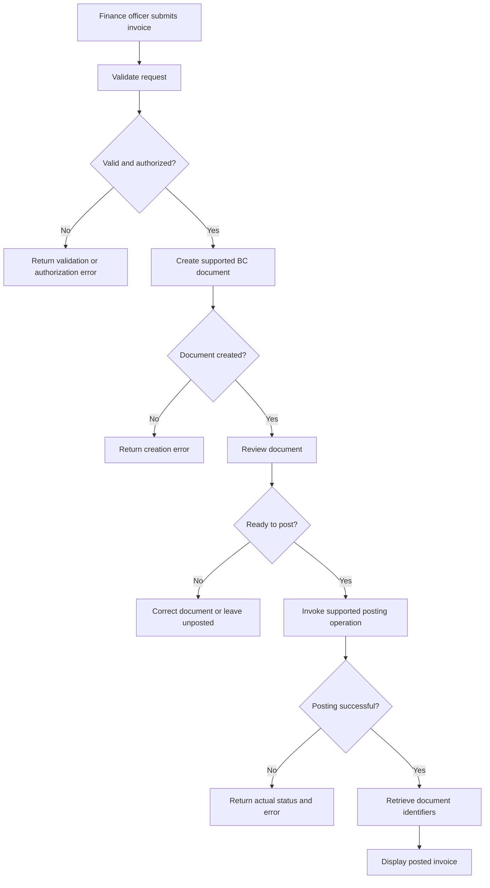
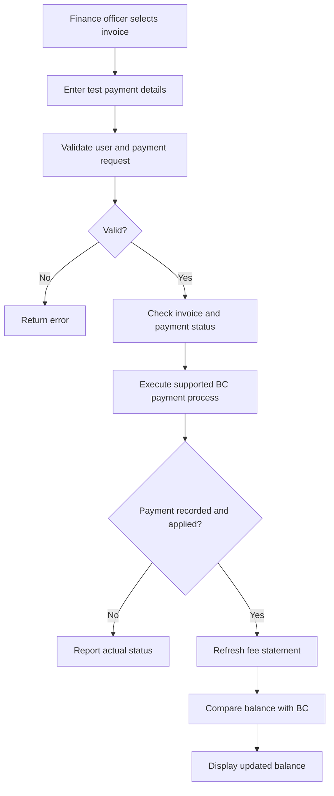
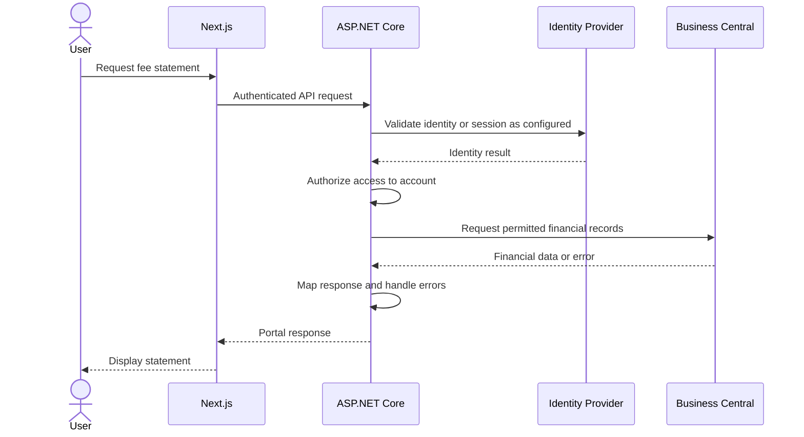
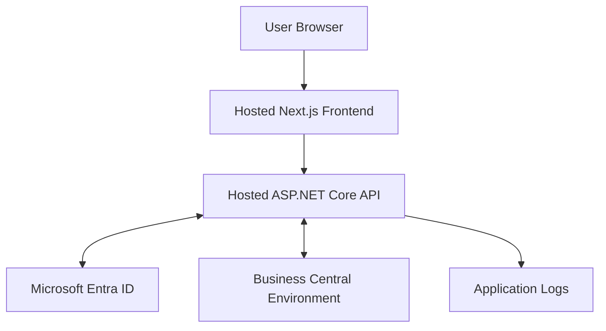

# System Flowcharts

## 1. System Context

## 2. Student Fee Statement

## 3. Invoice Creation and Posting

## 4. Test Payment Workflow

## 5. Integration Request Lifecycle

The precise authentication sequence will depend on the selected portal authentication design. The diagram represents the logical flow, not a commitment to a particular token-validation implementation.

## 6. Deployment Context

## 7. Diagram Maintenance

Update these diagrams whenever a major workflow, API boundary, authentication method or system responsibility changes.

Do not treat a diagram as proof that a feature exists. Implementation and tests must verify each workflow.
